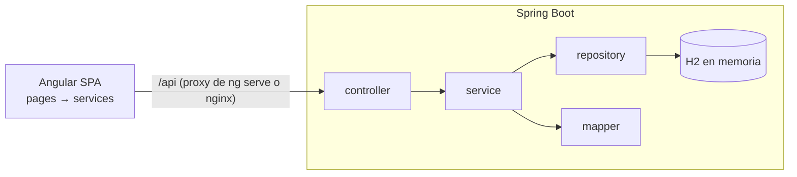
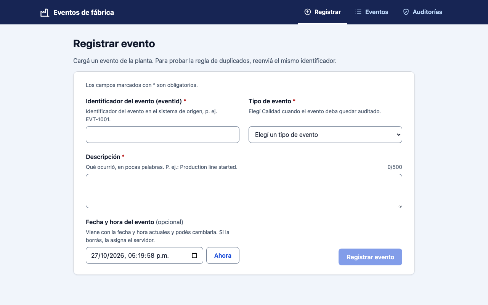
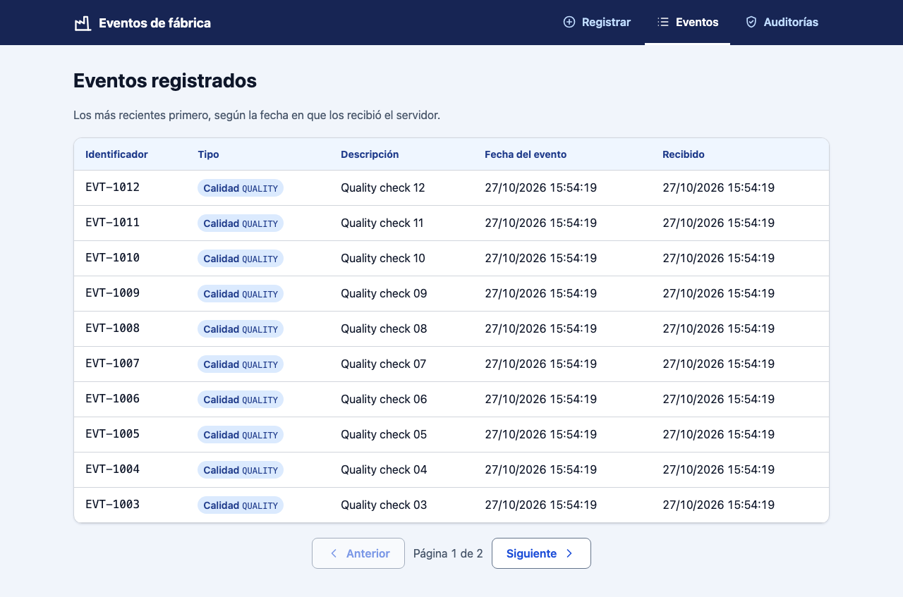
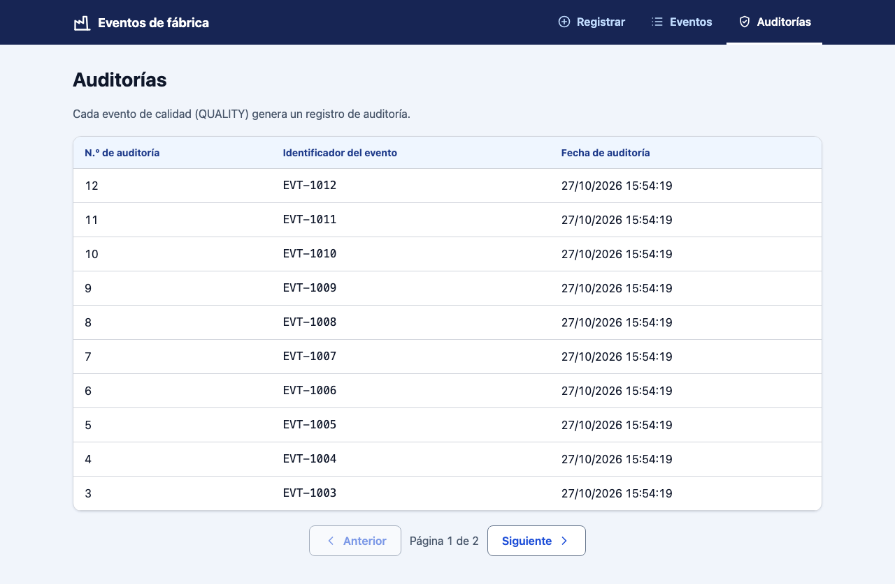
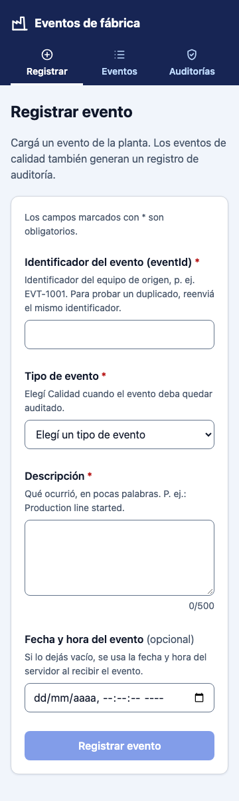
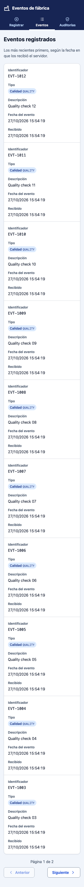
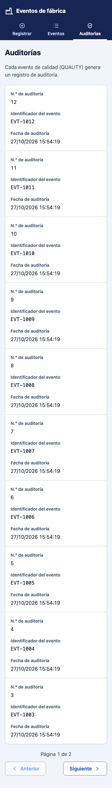
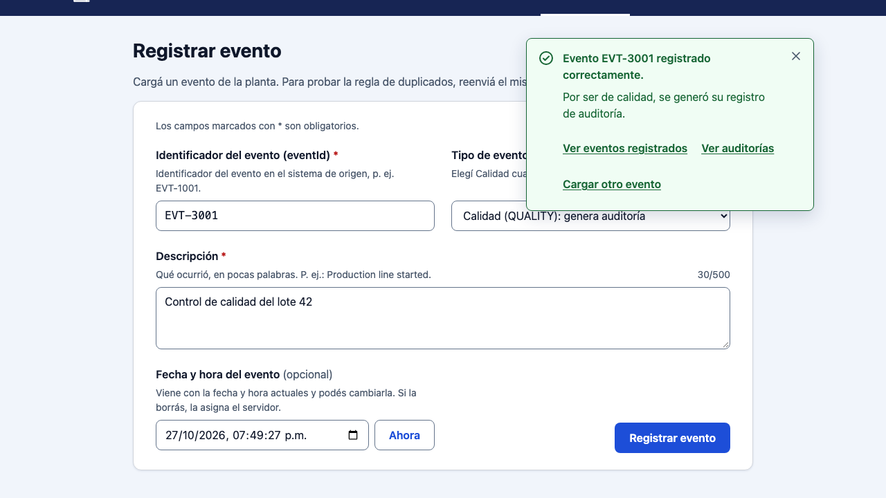

# Eventos de fábrica — Fullstack (Spring Boot + Angular)

[](https://github.com/Augustosensei/fujitsu-eventos-fullstack/actions/workflows/ci.yml)

Solución de la prueba técnica *Desarrollador Fullstack v6.0*. Un backend recibe los eventos
que envían los equipos de una fábrica (`PRODUCTION` y `QUALITY`), evita duplicados por
`eventId` y audita los de calidad. Un frontend permite registrarlos, reenviar el mismo
identificador para comprobar la regla de duplicados y consultar eventos y auditorías.

| Pieza | Tecnología |
|-------|------------|
| Backend | Java 17+ (desarrollado con Java 25), Spring Boot 4.1.2, Spring Data JPA + H2 en memoria, Bean Validation, MapStruct, Lombok, springdoc-openapi, Actuator + Micrometer |
| Frontend | Angular 22.2 (standalone, zoneless, signals, Signal Forms, `httpResource`), CSS propio |
| Pruebas | JUnit + Mockito + slices de Spring Boot, JaCoCo · Vitest + `HttpTestingController` |
| Entrega | Docker (multi-stage, sin root), nginx como proxy de `/api`, Docker Compose |

## Contenido

1. [Clonar](#clonar)
2. [Requisitos](#requisitos)
3. [Ejecutar](#ejecutar)
4. [Docker](#docker)
5. [Duplicado y auditoría](#duplicado-y-auditoría)
6. [Pruebas](#pruebas)
7. [API](#api)
8. [Timestamp](#timestamp)
9. [Arquitectura](#arquitectura)
10. [Decisiones](#decisiones)
11. [Observabilidad](#observabilidad)
12. [UI](#ui)
13. [Mejoras futuras](#mejoras-futuras)

## Clonar

```bash
git clone https://github.com/Augustosensei/fujitsu-eventos-fullstack.git
cd fujitsu-eventos-fullstack
```

Todos los comandos de este README se ejecutan desde la raíz del repositorio salvo que
empiecen con `cd`.

## Requisitos

| Herramienta | Versión | Para qué |
|-------------|---------|----------|
| JDK | 17 o superior | Backend. La CI corre todas las pruebas con JDK 17 y 25 en cada push; también se probó a mano con 21.0.1. Maven **no** hace falta: el repo trae el wrapper `./mvnw` (Maven 3.10.0). |
| Node.js | `^22.22.3 \|\| ^24.15.0 \|\| >=26.0.0` (rango `engines` de Angular CLI 22.2.4) | Frontend. Probado con Node 24.22.1 y npm 11.19.1. |
| Docker | Docker Engine con el plugin Compose (`docker compose`) | Opcional: levantar todo con un comando. Probado con Engine 29.9.2 y Compose 5.6.1. |

Versiones resueltas (las últimas estables al construir el proyecto): Spring Boot 4.1.2,
Angular 22.2.4, springdoc-openapi 3.2.0, MapStruct 1.6.3, lombok-mapstruct-binding 0.2.0,
JaCoCo 0.8.16, angular-eslint 22.6.0, `@vitest/coverage-v8` 5.0.5. Lombok y el resto de las
dependencias de Spring las fija Spring Boot.

## Ejecutar

Backend (puerto 8080):

```bash
cd backend
./mvnw spring-boot:run
```

Frontend (puerto 4200), en otra terminal:

```bash
cd frontend
npm ci
npm start
```

Con npm 11, `npm ci` avisa que algunos paquetes (esbuild, lmdb, …) tienen scripts de
instalación sin aprobar (`install-scripts`); es solo un aviso y no afecta la ejecución.

Abrir <http://localhost:4200>. En desarrollo, `ng serve` reenvía `/api` al backend en
`http://localhost:8080` (`frontend/proxy.conf.json`), así que el frontend usa siempre rutas
relativas.

Variables de entorno del backend (todas opcionales):

| Variable | Default | Uso |
|----------|---------|-----|
| `SERVER_PORT` | `8080` | Puerto HTTP. Si se cambia, ajustar el `target` de `frontend/proxy.conf.json`. |
| `APP_PAGINATION_DEFAULT_SIZE` | `20` | Tamaño de página cuando no se envía `size`. |
| `APP_PAGINATION_MAX_SIZE` | `100` | Máximo aceptado para `size`. |

La base es H2 en memoria: los datos se pierden al detener el backend.

## Docker

```bash
docker compose up --build -d
docker compose ps
```

| Servicio | Imagen base (runtime) | Puerto | Usuario |
|----------|-----------------------|--------|---------|
| `backend` | `eclipse-temurin:25-jre-alpine` | `8080:8080` | `app` (uid 100) |
| `frontend` | `nginxinc/nginx-unprivileged:stable-alpine` | `4200:8080` | `nginx` (uid 101) |

- UI en <http://localhost:4200>. nginx sirve la SPA (cualquier ruta, p. ej. `/events`, cae en
  `index.html`) y reenvía `/api/` al backend dentro de la red de Compose.
- El backend también queda publicado en <http://localhost:8080> (Swagger UI, Actuator).
- `docker compose ps` muestra el backend `(healthy)`: el healthcheck consulta
  `/actuator/health` con `wget` (el que trae la imagen Alpine; `curl` no está instalado), y
  el frontend arranca recién cuando el backend está sano.
- Las imágenes se construyen en dos etapas (build y runtime). En el backend, el pom y el
  wrapper se copian antes que el código para que un cambio en `src/` no vuelva a descargar
  las dependencias de Maven.
- El `package` dentro de `backend/Dockerfile` usa `-DskipTests` a propósito: las pruebas
  (con el umbral de cobertura) corren con `./mvnw verify` (ver [Pruebas](#pruebas)); repetirlas
  en cada build de la imagen solo la haría más lenta.
- Dentro del contenedor la zona horaria es UTC (ver [Timestamp](#timestamp)).

Detener y borrar los contenedores:

```bash
docker compose down
```

## Duplicado y auditoría

La regla del enunciado: el mismo `eventId` no genera un segundo evento ni una segunda
auditoría, ni desde la UI ni llamando a la API directamente.

### Desde la UI

1. Abrir <http://localhost:4200> (abre **Registrar evento**).
2. Completar **Identificador del evento** con `EVT-2001`, elegir **Calidad (QUALITY): genera
   auditoría**, escribir una descripción (p. ej. `Quality inspection failed`) y dejar la fecha
   vacía.
3. Presionar **Registrar evento**. Aparece *"Evento EVT-2001 registrado correctamente."* y
   *"Por ser de calidad, se generó su registro de auditoría."*
4. Presionar **Registrar evento** otra vez sin tocar nada (el formulario conserva los valores
   a propósito). Aparece el error *"El evento con eventId 'EVT-2001' ya estaba registrado; no
   se guardó ni se auditó de nuevo."*
5. Ir a **Auditorías**: hay una sola fila para `EVT-2001`. En **Eventos** también hay una sola.

### Con `curl`

Con el backend levantado (local o Docker). Primer envío de un evento QUALITY:

```bash
curl -s -i -X POST http://localhost:8080/api/events \
  -H 'Content-Type: application/json' \
  -d '{"eventId":"EVT-1001","eventType":"QUALITY","description":"Quality inspection failed","timestamp":"2026-05-20T10:00:00"}'
```

Respuesta esperada (`201 Created`; el `X-Correlation-Id` es un UUID nuevo en cada request y las fechas cambian):

```text
HTTP/1.1 201
X-Correlation-Id: ae862439-3216-44b8-b617-db68576b8a80
Location: /api/events/EVT-1001
Content-Type: application/json

{"eventId":"EVT-1001","eventType":"QUALITY","description":"Quality inspection failed","timestamp":"2026-05-20T10:00:00","receivedAt":"2026-10-26T22:24:56.634076Z"}
```

Reenvío del mismo comando, sin cambios. Respuesta esperada (`409 Conflict`):

```text
HTTP/1.1 409
X-Correlation-Id: cfe935f5-60d7-4b5f-ad5f-b4c3eb7fcf7e
Content-Type: application/problem+json

{"detail":"El evento con eventId 'EVT-1001' ya estaba registrado; no se guardó ni se auditó de nuevo.","instance":"/api/events","status":409,"title":"Evento duplicado","code":"DUPLICATE_EVENT","correlationId":"cfe935f5-60d7-4b5f-ad5f-b4c3eb7fcf7e"}
```

Verificar que hay una sola auditoría para ese evento:

```bash
curl -s http://localhost:8080/api/audits
```

```text
{"content":[{"id":1,"eventId":"EVT-1001","auditedAt":"2026-10-26T22:24:56.655431Z"}],"page":0,"size":20,"totalElements":1,"totalPages":1}
```

Con un evento `PRODUCTION` el reenvío también devuelve 409, pero `GET /api/audits` no suma
filas: solo los QUALITY se auditan. Con Docker, los mismos comandos funcionan contra
`http://localhost:4200/api/...` (pasando por nginx).

La regla no depende de la UI: el servicio consulta si el `eventId` existe y, además, la base
tiene una restricción UNIQUE sobre `eventId`. Si dos requests simultáneos pasan la consulta,
el segundo choca con la restricción y también recibe 409. Hay un test que dispara 10 envíos
concurrentes del mismo QUALITY y verifica 1×201, 9×409, 1 evento y 1 auditoría.

## Pruebas

Backend (tests + umbral de cobertura + reglas de Maven Enforcer):

```bash
cd backend
./mvnw -B -ntp verify
```

Reporte de cobertura: `backend/target/site/jacoco/index.html`.

Frontend (lint, formato, tests con cobertura y build de producción):

```bash
cd frontend
npm ci
npm run lint
npx prettier --check src
npx ng test --watch=false
npx ng build
```

Reporte de cobertura: `frontend/coverage/frontend/index.html`.

Ambos builds **fallan** si la cobertura de líneas baja del 100 %.

La CI de GitHub Actions (`.github/workflows/ci.yml`) corre en cada push a `main` y en cada
pull request: `./mvnw -B -ntp verify` con JDK 17 y con JDK 25 (Temurin), y lint, formato,
tests y build del frontend con Node 24. Los resultados están en la pestaña
[Actions](https://github.com/Augustosensei/fujitsu-eventos-fullstack/actions/workflows/ci.yml)
del repositorio.

| Capa | Herramienta | Qué cubre |
|------|-------------|-----------|
| Unit | JUnit + Mockito (repositorios simulados), `Clock` fijo, `SimpleMeterRegistry` | reglas PRODUCTION/QUALITY, duplicados, traducción de la UNIQUE, métricas, filtro de correlación, handler de errores |
| Web | `@WebMvcTest` (servicio simulado) | contrato HTTP: status, `Location`, cuerpos, `ProblemDetail`, validaciones, 405/406/415 |
| JPA | `@DataJpaTest` | orden y paginación, constraints con su nombre real, auditorías sin N+1 |
| Integración | `@SpringBootTest` | flujo completo con H2, concurrencia (10 hilos), rollback si falla la auditoría, Swagger y Actuator |
| Frontend | Vitest + `HttpTestingController` | servicios HTTP (URL, método, cuerpo) y mapeo de errores; formulario, listas, paginador y rutas interactuando por DOM |

Cada test lleva en su nombre el caso que prueba (p. ej. `EV-20` en `@DisplayName` o en el
`it(...)`).

Exclusiones de cobertura (las únicas): `EventsApplication` (el `main`), las
implementaciones `*MapperImpl` que genera MapStruct y `src/main.ts` del frontend. El código
que genera Lombok lo ignora JaCoCo porque Lombok lo marca con `@lombok.Generated`
(`backend/lombok.config`).

## API

Swagger UI: <http://localhost:8080/swagger-ui.html> · OpenAPI JSON:
<http://localhost:8080/v3/api-docs>.

| Método y ruta | Respuesta OK | Errores |
|---------------|--------------|---------|
| `POST /api/events` | `201` + `Location: /api/events/{eventId}` + evento | `400`, `406`, `409`, `415` |
| `GET /api/events?page&size` | `200` página de eventos (recepción más reciente primero) | `400`, `406` |
| `GET /api/events/{eventId}` | `200` evento | `400`, `404`, `406` |
| `GET /api/audits?page&size` | `200` página de auditorías (más reciente primero) | `400`, `406` |

Cuerpo de `POST /api/events` (el del enunciado; `timestamp` es opcional):

```json
{
  "eventId": "EVT-1001",
  "eventType": "PRODUCTION",
  "description": "Production line started",
  "timestamp": "2026-05-20T10:00:00"
}
```

| Campo | Regla |
|-------|-------|
| `eventId` | Obligatorio, texto. Se recortan los espacios de los extremos; después: máx. 64 caracteres, solo letras sin acentos, números, `-` y `_`. Distingue mayúsculas (`EVT-1001` ≠ `evt-1001`). |
| `eventType` | Obligatorio: `PRODUCTION` o `QUALITY`, exactamente así. |
| `description` | Obligatoria, texto, no vacía ni solo espacios, máx. 500 caracteres. Se guarda tal cual. |
| `timestamp` | Opcional, texto ISO-8601 sin zona (`2026-05-20T10:00`, `…T10:00:00`, `…T10:00:00.5`). Ver [Timestamp](#timestamp). |

Respuestas: `EventResponse` = los cuatro campos + `receivedAt` (instante de recepción, UTC).
`AuditResponse` = `id`, `eventId`, `auditedAt`. Las páginas tienen la forma
`{"content":[…],"page":0,"size":20,"totalElements":N,"totalPages":M}`; `page` arranca en 0,
`size` va de 1 a 100 (default 20). Pedir una página más allá del total devuelve `content`
vacío.

Errores: siempre `application/problem+json` (RFC 9457) con `title`, `detail` en español,
`code`, `correlationId` y, si hay campos inválidos, `errors: [{field, message}]`:

```text
{"detail":"La solicitud tiene datos inválidos. Revisá los campos indicados.","instance":"/api/events","status":400,"title":"Datos inválidos","code":"VALIDATION_ERROR","errors":[{"field":"eventType","message":"El valor de 'eventType' no es válido. Valores permitidos: PRODUCTION, QUALITY."}],"correlationId":"demo-123"}
```

| `code` | Status | Cuándo |
|--------|--------|--------|
| `VALIDATION_ERROR` | 400 | Campo faltante o inválido (incluye tipo JSON incorrecto, `eventType` desconocido, `timestamp` con zona o mal formado) y `eventId` inválido en la ruta |
| `MALFORMED_REQUEST` | 400 | Cuerpo vacío, JSON mal formado o raíz que no es un objeto |
| `INVALID_PAGINATION` | 400 | `page` o `size` fuera de rango o no numéricos |
| `DUPLICATE_EVENT` | 409 | El `eventId` ya estaba registrado |
| `EVENT_NOT_FOUND` | 404 | `GET /api/events/{eventId}` sin evento |
| `RESOURCE_NOT_FOUND` | 404 | Ruta inexistente |
| `METHOD_NOT_ALLOWED` | 405 | Método no soportado (p. ej. `PUT /api/events`) |
| `NOT_ACCEPTABLE` | 406 | `Accept` que no admite JSON (p. ej. `application/xml`) |
| `UNSUPPORTED_MEDIA_TYPE` | 415 | `Content-Type` distinto de `application/json` |
| `INTERNAL_ERROR` | 500 | Error inesperado; el cuerpo no expone detalles internos (el stack queda en el log) |

Propiedades JSON desconocidas en el cuerpo: se mantiene el comportamiento por defecto de
Spring Boot, que las **ignora** (el evento se registra con 201). Hay un test que lo fija.

## Timestamp

El enunciado deja elegir entre ingresarlo desde la interfaz o asignarlo en la aplicación. Se
admiten las dos cosas:

- Si el cuerpo trae `timestamp`, se usa ese valor tal cual.
- Si no viene (campo ausente o `null`), el servidor asigna la fecha y hora actual, truncada a
  segundos.
- El formato es el del ejemplo del enunciado: ISO-8601 **sin zona** (`LocalDateTime`). Se
  aceptan los segundos y la fracción como opcionales. Un valor con zona u offset (`Z`,
  `-03:00`), una fecha inexistente u otro formato (`20/05/2026`) da 400. El texto vacío o solo
  espacios también da 400: solo la ausencia del campo delega la fecha al servidor.
- Las fechas futuras o antiguas se aceptan: el enunciado no fija un rango.
- El valor que asigna el servidor usa la zona horaria del sistema donde corre. En Docker es
  UTC salvo que se defina la variable `TZ`.
- En la UI el campo **Fecha y hora del evento** es opcional (`datetime-local` con segundos). Si
  queda vacío, el frontend no lo envía y lo asigna el servidor.

`receivedAt` (recepción) y `auditedAt` (auditoría) los asigna siempre el servidor como
instantes UTC. La UI los muestra con formato `dd/MM/yyyy HH:mm:ss` en la hora local del
navegador.

## Arquitectura



Backend (`backend/src/main/java/com/fujitsu/events`), MVC por capas:

| Paquete | Responsabilidad |
|---------|-----------------|
| `controller` | `EventController`, `AuditController`: HTTP, `@Valid` y OpenAPI; sin lógica de negocio. |
| `service` | `EventService` (registro, regla de duplicados, auditoría en la misma transacción, métricas, logs), `AuditService`, `Paginator` (página validada → `Pageable` con el orden fijo). |
| `repository` | Spring Data JPA (`EventRepository`, `AuditRecordRepository` con `@EntityGraph`). |
| `model` | Entidades `Event`, `AuditRecord` y el enum `EventType`. |
| `dto` | Records de entrada/salida, validaciones (Bean Validation) y deserializadores estrictos. |
| `mapper` | MapStruct entre entidades y DTOs. |
| `exception` | Excepciones de dominio (`sealed`) con `ErrorCode` y el `@RestControllerAdvice` que arma los `ProblemDetail`. |
| `config` | `Clock`, propiedades de paginación, filtro `X-Correlation-Id`, OpenAPI. |

Frontend (`frontend/src/app`):

| Carpeta | Contenido |
|---------|-----------|
| `models/` | Tipos de la API, tipos de evento con sus textos, restricciones de campos (espejo del backend), errores de UI. |
| `services/` | `EventApi` y `AuditApi` (HTTP y `httpResource`), conversión de errores HTTP a mensajes. |
| `pages/` | `event-register`, `event-list`, `audit-list` y `shared/` (paginador, mensaje de estado, errores de campo). |

Rutas: `/events/new` (registrar), `/events` (eventos), `/audits` (auditorías); cualquier otra
redirige a `/events/new`.

## Decisiones

Lo que el enunciado deja a criterio del candidato se resolvió así. La regla general: nada
fuera de lo pedido (sin seguridad, colas, caché ni librerías de UI), como pide el enunciado
al priorizar la claridad.

### Dominio y persistencia

| Decisión | Por qué |
|----------|---------|
| H2 en memoria + Spring Data JPA, sin Flyway; esquema generado por Hibernate (`create-drop`), `open-in-view` desactivado, sin consola H2. | El enunciado admite "memoria, mocks o una base de datos sencilla". Una base real permite que una restricción UNIQUE garantice la regla aun con requests concurrentes; con una base en memoria que se recrea en cada arranque, las migraciones no aportan. |
| Unicidad por `eventId` con dos defensas: consulta previa + UNIQUE `uk_events_event_id`, traducida a 409 por el nombre de la restricción. | La consulta da el caso común sin excepción; la UNIQUE cubre la carrera entre requests simultáneos ("incluso cuando se invoque la API directamente"). |
| `eventId` recortado (`strip`), máx. 64, `^[A-Za-z0-9_-]+$`, distingue mayúsculas. | Un espacio accidental no debe crear otro evento. El `eventId` es la identidad del sistema de origen, así que se respeta tal cual (con mayúsculas); el patrón lo mantiene seguro dentro de la URL `/api/events/{eventId}`. |
| `description` obligatoria, máx. 500, sin recorte. | Es un texto libre: se guarda exactamente lo recibido. |
| `EventType` con `requiresAudit()` (solo QUALITY). | La regla PRODUCTION/QUALITY vive en un único lugar del dominio. |
| `Event` con `receivedAt` (UTC, del servidor); orden de listados por `receivedAt` y desempate por `id`, descendente. | Orden estable y "lo último primero" aunque dos eventos lleguen en el mismo instante. |
| `AuditRecord` (`id`, evento, `auditedAt`) creado en la **misma transacción** que el evento, con UNIQUE `uk_audit_records_event_id`. | Si la auditoría falla, el evento tampoco queda (rollback; hay un test). La UNIQUE impide una segunda auditoría del mismo evento. |
| La relación `AuditRecord → Event` es `@ManyToOne` obligatoria + la UNIQUE nombrada, no `@OneToOne`. | Con `@OneToOne`, Hibernate 7.4.13 descarta el nombre de la restricción y H2 la crea con un nombre genérico. Se verificó con el DDL. |
| Lectura de auditorías con `@EntityGraph`. | Evita N+1 al mostrar el `eventId` de cada auditoría (un test cuenta las sentencias SQL). |

### API y errores

| Decisión | Por qué |
|----------|---------|
| Duplicado → **409 Conflict**. | El `eventId` ya existe: conflicto con el estado del recurso, distinto de un dato inválido (400). |
| Errores como `ProblemDetail` (RFC 9457) con `code`, `errors` y `correlationId`. | Formato estándar que Spring soporta de forma nativa; `code` le da al cliente un valor estable para decidir (el frontend lo usa) y `detail` un mensaje comprensible. |
| Tipo o formato inválido en un campo → `VALIDATION_ERROR` con el nombre del campo; `MALFORMED_REQUEST` solo si el JSON no se puede leer como objeto. | El usuario ve qué campo corregir. |
| `eventId` y `description` solo como texto JSON (un número o booleano da 400). | Sin conversiones silenciosas de Jackson (`1001` → `"1001"`). |
| El `eventId` de `GET /api/events/{eventId}` recibe el mismo recorte que en el alta. | El mismo identificador se encuentra igual en las dos operaciones. |
| `Accept` no soportado → 406 con `ProblemDetail`. | Todos los errores tienen el mismo formato. |
| Paginación en el servidor: `page` ≥ 0, `size` 1–100 (configurables), validados con Bean Validation. | Las listas crecen sin límite; fuera de rango es un error explícito (`INVALID_PAGINATION`) y no un recorte silencioso. |
| Toda entrada HTTP se valida con Bean Validation (sin `if` de validación en controllers ni services). | Una sola forma de validar, declarativa y probada por capa. |
| Respuesta `201` con `Location`. | Semántica REST de creación; apunta a `GET /api/events/{eventId}`. |
| Sin autenticación. | No la pide el enunciado (ver [Mejoras futuras](#mejoras-futuras)). |

### Frontend

| Decisión | Por qué |
|----------|---------|
| Tres rutas con menú: registrar, eventos, auditorías. | Separa las tareas; cada pantalla tiene su título de pestaña. |
| Tras un registro exitoso el formulario **conserva** los valores. | El enunciado pide poder reenviar el mismo `eventId` para probar la regla de duplicados. |
| El resultado del envío se muestra en un aviso flotante arriba a la derecha (`position: sticky`), que queda hasta cerrarlo o hasta el próximo envío; los errores de cada campo siguen debajo del campo. | El usuario ve el resultado sin bajar ni perder de vista el formulario, y puede reenviar enseguida para probar el duplicado. El aviso no se cierra solo, así hay tiempo de leerlo y usar sus enlaces. |
| Las tablas de eventos y auditorías piden 10 filas por página (`size=10`); la API mantiene su valor por defecto (20) para quien la use directo. | Con 10 filas la tabla entra casi completa en una notebook (medido: 10 filas visibles en 1440×800, 9 en 1280×720) y el paginador queda cerca; el tamaño de página es una decisión de la pantalla, no del contrato de la API. |
| Validaciones locales espejo del backend (incluido el recorte del `eventId`); el backend sigue siendo la fuente de verdad. | Feedback inmediato sin depender de un request; los errores del servidor también se muestran bajo cada campo. |
| Con el formulario inválido, el botón se ve deshabilitado (`aria-disabled`) pero al presionarlo marca los errores y lleva el foco al primer campo inválido; durante el envío está deshabilitado de verdad. | El usuario siempre sabe qué falta, y no hay doble envío. |
| `timestamp` vacío no se envía. | Así lo asigna el servidor. |
| Servicios `EventApi` y `AuditApi`; `provideHttpClient()` sin `withFetch()`. | Nombres que no chocan con globales del DOM (`Event`). En Angular 22 `withFetch()` está deprecado porque `fetch` ya es el backend por defecto (hay un test que lo verifica). |
| CSS propio, sin librerías de UI. | Es suficiente para tres pantallas y evita dependencias que el enunciado no pide. |

### Build, calidad y entrega

| Decisión | Por qué |
|----------|---------|
| Spring Boot 4 y Angular 22 (las últimas estables); backend compilado para Java 17 (`--release 17`) y desarrollado con Java 25 LTS. | Java 17 es el mínimo que admite Spring Boot 4: así el backend corre con cualquier JDK desde 17 sin perder records, `sealed` ni `switch` como expresión. Las imágenes Docker usan Java 25. |
| Maven con wrapper (`./mvnw`) y Maven Enforcer (Java ≥ 17, Maven ≥ 3.9, sin versiones duplicadas, sin SNAPSHOT). Con JDK 23 o superior, un perfil (`jdk23-unsafe-memory-access`) compila en un proceso aparte con `--sun-misc-unsafe-memory-access=allow`. | Build reproducible sin instalar Maven. El perfil evita el aviso de `sun.misc.Unsafe` que Lombok produce en JDK recientes; esa opción no existe antes de JDK 23, por eso no puede ir fija para todas las versiones. |
| Lombok solo para `@RequiredArgsConstructor` (inyección por constructor), `@Getter` + constructor protegido en entidades, `@Getter` en la excepción base (para su `ErrorCode`) y `@Slf4j`; prohibidos `@Data`, `@Setter`, `@Builder` y similares (`lombok.config`). | Menos código repetido sin perder inmutabilidad: las entidades no tienen setters y los datos viajan en records. |
| Cobertura mínima 100 % de líneas en backend y frontend. | Cada línea de producción tiene al menos un test que la ejecuta; las exclusiones están listadas en [Pruebas](#pruebas). |
| Identificadores en inglés; mensajes al usuario (API y UI) en español rioplatense. | Convención habitual del código; el enunciado está en español de Argentina. |
| Paquete base `com.fujitsu.events`. | Agrupa todo el backend bajo un único espacio de nombres. |
| Docker: dos imágenes multi-stage sin root + Compose con healthcheck. | Levantar todo con un comando y comprobar la solución sin instalar JDK ni Node. |
| Repositorio público en GitHub. | Forma de entrega pedida por el enunciado. |
| CI con GitHub Actions: backend con JDK 17 y 25, frontend con Node 24. | Demuestra en cada push que el backend funciona en el mínimo soportado (17) y en el JDK de desarrollo (25); un test JUnit no puede probarlo porque corre en una sola JVM. |

## Observabilidad

- **`X-Correlation-Id`**: si el request trae uno válido (`^[A-Za-z0-9-]{1,64}$`) se reutiliza;
  si no, se genera un UUID. Se devuelve en el header de la respuesta, en `correlationId` de los
  errores y en cada línea de log del request:

  ```text
  INFO [ae862439-3216-44b8-b617-db68576b8a80] … c.fujitsu.events.service.AuditService : Audit record created: id=1, eventId=EVT-1001
  INFO [ae862439-3216-44b8-b617-db68576b8a80] … c.fujitsu.events.service.EventService : Event registered: eventId=EVT-1001, type=QUALITY
  WARN [cfe935f5-60d7-4b5f-ad5f-b4c3eb7fcf7e] … c.fujitsu.events.service.EventService : Duplicate event rejected: eventId=EVT-1001
  WARN [cfe935f5-60d7-4b5f-ad5f-b4c3eb7fcf7e] … c.f.e.exception.GlobalExceptionHandler : Request rejected: uri=/api/events -> 409 DUPLICATE_EVENT
  ```

- **Logs**: INFO al registrar y auditar, WARN en duplicados y requests rechazados, ERROR con
  stack en los 500.
- **Actuator**: `/actuator/health`, `/actuator/info` y `/actuator/metrics`.
- **Métricas Micrometer**: `events.registered` (tag `type`) y `events.duplicates`.

  ```bash
  curl -s http://localhost:8080/actuator/health
  curl -s http://localhost:8080/actuator/metrics/events.duplicates
  curl -s 'http://localhost:8080/actuator/metrics/events.registered?tag=type:QUALITY'
  ```

## UI

| Registrar | Eventos | Auditorías |
|-----------|---------|------------|
|  |  |  |
|  |  |  |

Capturas a 1280 px (escritorio) y 360 px (móvil). Resultado de un registro, como aviso
flotante:



- **Responsive, mobile-first**: diseño base para 360 px, cortes en 640 px y 1024 px, contenido
  centrado con un máximo de 1120 px. En pantallas angostas la navegación son tres pestañas de
  igual ancho y cada fila de las tablas se muestra como tarjeta con la etiqueta de cada dato.
  Desde 1024 px el formulario de registro usa dos columnas y entra completo, con el botón, en
  una ventana de 1280×720. Sin scroll horizontal en 360, 768 ni 1280 px (verificado con capturas).
- **Pensada para un usuario común**: ayuda y ejemplo en cada campo, tipos con texto amigable
  ("Calidad (QUALITY): genera auditoría"), contador de caracteres, errores bajo cada campo,
  resultado en un aviso arriba a la derecha que queda a la vista aunque la página esté
  desplazada, con el próximo paso ("Ver eventos registrados", "Ver auditorías") y botón para
  cerrarlo, duplicado explicado, estados de carga, vacío (con botón para registrar) y error
  (con "Reintentar").
- **Paleta azul** definida como variables CSS en `frontend/src/styles.css`:

  | Uso | Color |
  |-----|-------|
  | Encabezado | `#172554` |
  | Botón primario / hover | `#1d4ed8` / `#1e40af` |
  | Foco | `#2563eb` |
  | Fondo / superficie | `#f1f5fb` / `#ffffff` |
  | Texto / secundario | `#0f172a` / `#475569` |
  | Encabezado de tabla y badge QUALITY | `#1e3a8a` sobre `#eff6ff` / `#dbeafe` |
  | Badge PRODUCTION | `#0c4a6e` sobre `#e0f2fe` |

  Verde y rojo se usan solo en mensajes de éxito y error, siempre con ícono y texto.
- **Accesibilidad**: contraste WCAG AA medido para cada par texto/fondo (≥ 4.5:1; ≥ 3:1 en
  foco y bordes de campos), foco visible, todo usable con teclado, áreas táctiles de al menos
  44 px, mensajes en regiones `aria-live`, `lang="es-AR"` y título de pestaña por página.

## Mejoras futuras

- **Seguridad**: autenticación de los equipos que envían eventos (p. ej. OAuth2 con
  credenciales de cliente) y de los usuarios de la UI, HTTPS, límites de tasa.
- **Persistencia durable**: una base como PostgreSQL con migraciones versionadas (Flyway) en
  lugar de H2 en memoria y esquema generado.
- **Integración por eventos**: publicar "evento registrado" y "auditoría creada" con el
  patrón outbox (misma transacción, entrega garantizada) en lugar de llamadas directas.
- **Pruebas end-to-end** del flujo completo en navegador (p. ej. Playwright) contra el stack de
  Docker Compose.
- **CI**: sumar al workflow el build de las imágenes y el smoke de Docker Compose.
- **Consultas**: filtros por tipo, rango de fechas o `eventId` en las listas.
